# Laporan Audit Kode & Arsitektur WM-Toolkit

> **Tanggal Audit:** 9 November 2026  
> **Aplikasi:** WM-Toolkit (Pencatatan & Monitoring Proyek Teknis Perkebunan Kelapa Sawit)  
> **Teknologi Utama:** Next.js 15.1.0 (App Router), React 19, TypeScript 5.7, Tailwind CSS 3.4, shadcn/ui, Recharts 2.15, Sonner  
> **Status Build:** Berhasil 100% (`pnpm build` sukses mengompilasi seluruh 33 rute App Router tanpa error TypeScript atau linting)

---

## Ringkasan Eksekutif

Audit ini dilakukan terhadap repositori **WM-Toolkit** setelah serangkaian pembaruan besar pada antarmuka dan alur operasional:
1. **Pembaruan Dashboard Operasional & Jejak Audit (`/dashboard`):** Transformasi dashboard menjadi Pusat Komando Operasional dua tab (`overview` & `audit-log`), dilengkapi filter interaktif wilayah & status fokus, visualisasi dua jalur pengadaan (*Dual-Track Pipeline Status Bar*), linimasa multi-proyek tunggal (*Unified Gantt Timeline*), workstation operasional 2-kolom seimbang (4 modul), serta pusat inspeksi jejak audit (*Audit Log Viewer* & *JSON Diff Detail Dialog*).
2. **Konsolidasi Workspace Proyek (`/workspace/[projectId]`):** Penyederhanaan navigasi detail proyek menjadi **4 Primary Integrated Tabs** (*Ringkasan Proyek*, *Otorisasi AFCE*, *Pengadaan & Kontrak*, dan *Pelaksanaan & Progres*), panduan siklus hidup interaktif (*Smart Action Stepper*), serta laci geser terpadu (*Universal Collaboration Drawer*) untuk diskusi komentar (@mention), dokumen berkas, dan log audit per proyek.

Aplikasi saat ini berstatus **Front-end Prototype berbasis LocalStorage & React Context API** yang sangat matang dan lengkap. Seluruh 10 cakupan fitur spesifikasi MVP (**F1 s/d F10** ditambah **AUTH**) telah memiliki implementasi antarmuka pengguna (UI/UX) yang 100% fungsional pada data mock lokal. Persiapan selanjutnya berfokus pada transisi arsitektur menuju database relasional PostgreSQL + Prisma ORM dan sistem autentikasi sesi NextAuth.

---

## 1. Pemetaan 33 Rute App Router

Hasil kompilasi build produksi Next.js mencatat **33 rute App Router aktif**, dengan pengelompokan fungsi sebagai berikut:

| No | Path Rute | Tipe Render | Berkas Sumber | Fungsi & Deskripsi Fitur |
|---|---|---|---|---|
| **A** | **Root & Autentikasi** | | | |
| 1 | `/` | Static (Redirect) | `src/app/page.tsx` | Entry point utama aplikasi; otomatis me-redirect pengguna ke `/dashboard`. |
| 2 | `/_not-found` | Static | `src/app/not-found.tsx` | Halaman penanganan 404 kustom dengan tombol kembali ke dashboard. |
| 3 | `/login` | Static | `src/app/login/page.tsx` | Halaman autentikasi simulasi login pengguna dengan tombol preset peran (Admin, PIC, Viewer), validasi form, dan indikator keamanan. |
| **B** | **Dashboard & Notifikasi** | | | |
| 4 | `/dashboard` | Static (Client Hydrated) | `src/app/dashboard/page.tsx` | **Pusat Komando Operasional & Jejak Audit (Dual-Tab)**: Tab 1 Ringkasan Operasional (Hero KPI, Dual Pipeline, Unified Gantt, 4-Modul Workstation) & Tab 2 Pusat Jejak Audit (Audit Log Viewer & Diff Inspector). |
| 5 | `/notifications` | Static | `src/app/notifications/page.tsx` | **Pusat Notifikasi & Alarm EWS**: Filter tab (Semua, Belum Dibaca, Keterlambatan, Approval AFCE, Tugas Baru, Reminder Deadline), KPI peringatan, penanda sudah dibaca, dan simulasi picu Vercel Cron. |
| 6 | `/settings` | Static | `src/app/settings/page.tsx` | **Pengaturan Sistem & Profil**: Konfigurasi profil pengguna aktif, pemilihan peran simulasi, preferensi format tanggal/angka, sakelar tipe notifikasi, serta pemeliharaan data (reset benih demo, ekspor JSON, impor JSON). |
| **C** | **Monitoring & Master Data** | | | |
| 7 | `/workspace` | Static | `src/app/workspace/page.tsx` | **Daftar & Monitoring Proyek**: Data table interaktif, pencarian multi-parameter, filter lokasi/status/varians jadwal, pengaturan densitas tabel, aksi hapus proyek (*soft delete*), tombol restore recycle bin, dan ekspor data proyek. |
| 8 | `/workspace/new` | Static | `src/app/workspace/new/page.tsx` | **Wizard Pembuatan Proyek Baru (4 Langkah)**: Formulir multi-langkah: 1) Informasi Umum & Lokasi Wilayah/Kebun/Blok, 2) Jadwal Baseline & Durasi, 3) Anggaran & Dokumen AFCE, 4) Definisi WBS Awal. Dilengkapi *circular progress ring*. |
| 9 | `/master-data` | Static | `src/app/master-data/page.tsx` | **Hub Master Data**: Dashboard katalog ringkasan entitas organisasi, kebun, logistik, vendor rekanan, dan tata kelola beserta pintasan langsung ke sub-modul. |
| 10 | `/master-data/approval-matrix` | Static | `src/app/master-data/approval-matrix/page.tsx` | Konfigurasi matriks persetujuan berjenjang 9 level hierarki berdasarkan batas nilai anggaran belanja modal proyek. |
| 11 | `/master-data/locations` | Static | `src/app/master-data/locations/page.tsx` | Pengelolaan data multi-entitas organisasi: Wilayah Operasional (Region), Perusahaan (PT), Unit Kebun (Estate/PKS), serta Blok & Afdeling kebun sawit. |
| 12 | `/master-data/materials` | Static | `src/app/master-data/materials/page.tsx` | Katalog material konstruksi & sipil kebun sawit, kode material SAP, satuan standar, dan patokan harga. |
| 13 | `/master-data/procurement-types` | Static | `src/app/master-data/procurement-types/page.tsx` | Parameter klasifikasi metode pengadaan (Tender Terbuka, Tender Terbatas, Swakelola, Pembelian Langsung). |
| 14 | `/master-data/project-categories` | Static | `src/app/master-data/project-categories/page.tsx` | Klasifikasi bidang pekerjaan proyek kebun (Bangunan Air, Jalan & Jembatan, Infrastruktur Emplasmen, Konservasi). |
| 15 | `/master-data/project-types` | Static | `src/app/master-data/project-types/page.tsx` | Pengelompokan tipe proyek (Fisik/Konstruksi, Pengadaan Material Saja, Turnkey/Gabungan). |
| 16 | `/master-data/suppliers` | Static | `src/app/master-data/suppliers/page.tsx` | Direktori rekanan vendor/kontraktor (nama vendor, NPWP, kontak personal, telepon, kategori bidang, dan rating bintang). |
| 17 | `/master-data/users` | Static | `src/app/master-data/users/page.tsx` | Manajemen profil pengguna kebun, email, peran otorisasi, penugasan wilayah, dan status aktif. |
| **D** | **Workspace Proyek: 4 Hub Terpadu (Primary Tabs)** | | | |
| 18 | `/workspace/[projectId]` | Dynamic | `src/app/workspace/[projectId]/page.tsx` | **Primary Tab 1: Ringkasan Proyek (Overview)**: Memuat *Smart Action Stepper*, metrik ringkasan anggaran, durasi hari, status pengadaan, progres fisik, dan 5 log aktivitas harian terbaru. |
| 19 | `/workspace/[projectId]/afce` | Dynamic | `src/app/workspace/[projectId]/afce/page.tsx` | **Primary Tab 2: Otorisasi AFCE**: Visualisasi jenjang matriks persetujuan SAP, kartu status verifikasi per jabatan, log approval, dan modal dialog pencatatan persetujuan manual. |
| 20 | `/workspace/[projectId]/procurement` | Dynamic | `src/app/workspace/[projectId]/procurement/page.tsx` | **Primary Tab 3: Hub Pengadaan & Kontrak Terpadu**: Mengintegrasikan seluruh siklus **Jalur Barang** (PR, Evaluasi Rekanan Barang, PO, GR, BAST) dan **Jalur Jasa** (USPK, Evaluasi Teknis Jasa, Kontrak SPK Resmi) dalam satu antarmuka tab modular. |
| 21 | `/workspace/[projectId]/execution` | Dynamic | `src/app/workspace/[projectId]/execution/page.tsx` | **Primary Tab 4: Hub Pelaksanaan & Progres Terpadu**: Mengintegrasikan Kurva S fisik (Recharts), log harian & mingguan, struktur rincian kerja (WBS), matriks jadwal Gantt mingguan, adendum revisi jadwal, serta rincian Bill of Quantity (BOQ). |
| **E** | **Workspace Proyek: Sub-Rute Khusus (Direct Linkable)** | | | |
| 22 | `/workspace/[projectId]/pr` | Dynamic | `src/app/workspace/[projectId]/pr/page.tsx` | Monitoring Purchase Requisition SAP, status rilis, evaluasi vendor barang, dan tautan pembuatan PO. |
| 23 | `/workspace/[projectId]/po` | Dynamic | `src/app/workspace/[projectId]/po/page.tsx` | Monitoring Purchase Order terbit, rincian barang, input Goods Receipt (GR), dan pencatatan BAST formal. |
| 24 | `/workspace/[projectId]/services` | Dynamic | `src/app/workspace/[projectId]/services/page.tsx` | Halaman khusus Jalur Jasa mandiri: daftar usulan USPK, evaluasi teknis, dan kontrak SPK. |
| 25 | `/workspace/[projectId]/uspk` | Dynamic | `src/app/workspace/[projectId]/uspk/page.tsx` | Sub-rute daftar Usulan SPK teknis proyek terpilih. |
| 26 | `/workspace/[projectId]/technical-evaluation` | Dynamic | `src/app/workspace/[projectId]/technical-evaluation/page.tsx` | Sub-rute evaluasi kelayakan teknis penawaran jasa kontraktor. |
| 27 | `/workspace/[projectId]/spk` | Dynamic | `src/app/workspace/[projectId]/spk/page.tsx` | Sub-rute kontrak kerja resmi Surat Perintah Kerja (SPK). |
| 28 | `/workspace/[projectId]/progress` | Dynamic | `src/app/workspace/[projectId]/progress/page.tsx` | Sub-rute Kurva S rencana vs aktual kumulatif dan pencatatan log harian/mingguan. |
| 29 | `/workspace/[projectId]/schedule` | Dynamic | `src/app/workspace/[projectId]/schedule/page.tsx` | Sub-rute perbandingan baseline vs target revisi dan matriks Gantt mingguan. |
| 30 | `/workspace/[projectId]/survey-boq` | Dynamic | `src/app/workspace/[projectId]/survey-boq/page.tsx` | Sub-rute rincian Bill of Quantity (BOQ) teknis lapangan. |
| 31 | `/workspace/[projectId]/work-items` | Dynamic | `src/app/workspace/[projectId]/work-items/page.tsx` | Sub-rute Work Breakdown Structure (WBS) pembagian bobot 100%. |
| 32 | `/workspace/[projectId]/documents` | Dynamic | `src/app/workspace/[projectId]/documents/page.tsx` | Sub-rute repositori dokumen proyek, dialog upload, dan simulasi Google Drive link. |
| 33 | `/workspace/[projectId]/comments` | Dynamic | `src/app/workspace/[projectId]/comments/page.tsx` | Sub-rute diskusi dan komentar tim proyek dengan deteksi mention `@user`. |

> **Catatan Arsitektur Layout Proyek:**
> Layout `src/app/workspace/[projectId]/layout.tsx` membungkus header proyek permanen, status badge, tombol aksi cepat, banner soft delete / pulihkan proyek, tombol pemicu laci geser `CollaborationDrawer` (*Berkas & Diskusi*), serta strip navigasi **4 Primary Integrated Tabs**. Sub-rute granular nomor 22-33 tetap dipertahankan agar tautan lama, riwayat peramban, maupun deep-linking langsung tidak mengalami error 404.

---

## 2. Struktur Komponen Repositori

Komponen antarmuka tersusun terstruktur di bawah direktori `src/components/`:

### A. Komponen Tata Letak (Layout)
- `src/components/layout/app-layout-shell.tsx`: Pembungkus utama aplikasi yang menyatukan sidebar lipat, topbar, dan area konten responsif.
- `src/components/layout/app-sidebar.tsx`: Navigasi samping dengan collapsible state, pengelompokan menu Dashboard, Workspace, Master Data (dengan submenu lipat), dan Settings.
- `src/components/layout/app-topbar.tsx`: Header atas dengan indikator wilayah, Global Search (`Ctrl+K`), tombol Reset Data Mock, dropdown lonceng notifikasi dinamis (menghitung proyek terlambat & AFCE pending approval), tombol tema gelap/terang, dan avatar profil pengguna.
- `src/components/layout/global-search.tsx`: Palet perintah pencarian universal (`CommandDialog`) yang mengindeks kode proyek, nama proyek, dokumen AFCE, nomor PR, nomor PO, kebun, dan material.

### B. Komponen Dashboard (Pembaruan Utama)
- `src/components/dashboard/dashboard-filter-bar.tsx`: Komponen selektor filter Unit Kebun (dinamis dari master data `locations`) dan filter status fokus (`critical`, `in_progress`, `pending_afce`), badge jumlah proyek tersaring, dan tombol reset filter.
- `src/components/dashboard/pipeline-status-bar.tsx`: Visualisasi alur kerja dua cabang paralel pasca-AFCE: 4 tahapan Jalur Barang (*AFCE Setuju*, *PR Released*, *PO Terbit*, *GR Diterima*) dan 4 tahapan Jalur Jasa (*Usulan USPK*, *Eval Teknis Rekomendasi*, *SPK Aktif*, *Konstruksi Berjalan*).
- `src/components/dashboard/unified-gantt.tsx`: Linimasa multi-proyek tunggal terpadu multi-kebun. Menerima props proyek tersaring, kalkulasi rentang waktu otomatis, kontrol zoom 3 tingkat (*Weekly*, *Monthly*, *Quarterly*), filter status baris internal, garis penanda *Hari Ini* dengan auto-scroll halus, serta baris expandable WBS per proyek.
- `src/components/dashboard/dashboard-widgets.tsx`: Grid 2 kolom seimbang (7/12 & 5/12) menaungi 4 modul operasional:
  - *Modul A (Kiri Atas):* Pusat Tindakan & Atensi (Tab Antrean AFCE & Tab Peringatan EWS Kritis) dengan link aksi langsung.
  - *Modul B (Kiri Bawah):* Realisasi Progres Fisik & Kurva-S Mingguan (dual-bar rencana vs aktual).
  - *Modul C (Kanan Atas):* Pelacakan Pengadaan Dua Jalur (Tab Barang PR/PO & Tab Jasa SPK/USPK) dengan shortcut aksi.
  - *Modul D (Kanan Bawah):* Live Audit Feed 5 mutasi sistem terakhir dengan tombol inspeksi JSON Diff.
- `src/components/dashboard/audit-log-viewer.tsx`: Konsol Pusat Jejak Audit lengkap pada Tab 2 dashboard, memuat metrik ringkasan, multi-filter kategori entitas (*Barang, Jasa, AFCE, Proyek, Fisik*), filter jenis aksi, pencarian bebas, ekspor file CSV, dan daftar log audit kronologis.
- `src/components/dashboard/audit-log-detail-dialog.tsx`: Modal dialog inspeksi JSON Diff per rekaman audit log (*Before Data* vs *After Data*).
- `src/components/dashboard/kpi-card.tsx`: Komponen kartu ringkasan KPI eksekutif dengan ikon, tren, warna aksen semantik, dan tautan navigasi.

### C. Komponen Workspace & Siklus Hidup Proyek
- `src/components/workspace/smart-action-stepper.tsx`: Panduan visual tahapan siklus proyek (Inisiasi → Otorisasi AFCE → Pengadaan Barang/Jasa → Kontrak/PO → Pelaksanaan Fisik → Penutupan Proyek) yang mendeteksi status riil proyek dan memunculkan tombol aksi kontekstual berikutnya.
- `src/components/workspace/collaboration-drawer.tsx`: Laci geser samping (*Sheet*) yang menampung tab Diskusi Komentar (@mention), Dokumen Arsip & Google Drive simulator, serta linimasa Jejak Audit proyek.
- `src/components/workspace/schedule-gantt-matrix.tsx`: Matriks jadwal batang kerja mingguan per gugus pekerjaan teknis dengan sel status.
- `src/components/workspace/schedule-revision-dialog.tsx`: Modal dialog pengajuan revisi adendum waktu keterlambatan proyek dengan justifikasi cuaca/teknis dan pejabat pemberi izin.

### D. Komponen Pengadaan & Kontrak (Procurement & Services)
- `src/components/procurement/pr-record-dialog.tsx`: Dialog formulir pencatatan rilis PR SAP.
- `src/components/procurement/vendor-evaluation-dialog.tsx`: Dialog formulir pencatatan evaluasi vendor rekanan barang (rekomendasi teknis/komersial) sebagai guardrail sebelum menerbitkan PO.
- `src/components/procurement/po-create-dialog.tsx`: Dialog pembuatan Purchase Order multi-item material yang terhubung ke nomor PR dan vendor terpilih.
- `src/components/procurement/gr-receipt-dialog.tsx`: Dialog pencatatan penerimaan fisik barang parsial di kebun (Goods Receipt).
- `src/components/procurement/goods-handover-dialog.tsx`: Dialog pencatatan Berita Acara Serah Terima (BAST) barang formal antara pihak penyedia dan unit kebun.
- `src/components/services/uspk-create-dialog.tsx`: Dialog pembuatan Usulan SPK teknis jasa kebun.
- `src/components/services/technical-evaluation-dialog.tsx`: Dialog evaluasi teknis rekanan jasa (rekomendasi kelaikan kerja).
- `src/components/services/spk-create-dialog.tsx`: Dialog penerbitan kontrak resmi Surat Perintah Kerja (SPK).

### E. Komponen Otorisasi AFCE & Progres Lapangan
- `src/components/afce/afce-action-dialog.tsx`: Dialog pencatatan aksi approval AFCE manual (Approve, Revise, Reject) per level jabatan berdasarkan data SAP.
- `src/components/progress/daily-progress-dialog.tsx`: Dialog pelaporan aktivitas harian lapangan: volume terpasang, cuaca, jumlah tenaga kerja (manpower), catatan kendala, dan simulasi foto lapangan.
- `src/components/progress/weekly-progress-dialog.tsx`: Dialog rekapitulasi progres mingguan untuk kalkulasi deviasi Kurva S.

### F. Komponen Komentar & Dokumen
- `src/components/comments/comment-form.tsx` & `comment-list.tsx`: Komponen percakapan tim dengan deteksi mention `@user`.
- `src/components/documents/gdrive-link-dialog.tsx` & `gdrive-upload-dialog.tsx`: Dialog penautan URL berkas Google Drive dan modal simulasi upload berkas ke Google Drive.

### G. Komponen Primitif UI (shadcn/ui & Radix UI)
Terletak pada `src/components/ui/` mencakup: `avatar`, `badge`, `button`, `card`, `command`, `dialog`, `dropdown-menu`, `input`, `popover`, `progress`, `searchable-select`, `select`, `separator`, `sheet`, `switch`, `table`, `tabs`, `textarea`, `timeline`, dan `tooltip`.

---

## 3. Mock Data & State Management Terkini

Aplikasi berjalan pada pola **React Context API + Web LocalStorage** dengan isolasi data yang reaktif:
- **Konteks Utama:** `src/context/app-state-context.tsx` (`AppStateProvider`).
- **Kunci Browser Storage:** `wm_toolkit_state_v1`.
- **Dataset Mock Seed Bawaan (`src/lib/mock-data/`):**
  - `projects.ts`: 5 proyek perkebunan sawit realistis dengan varians jadwal, WBS, BOQ, dan jadwal Gantt.
  - `afce.ts`: Dokumen AFCE dengan jejak riwayat approval berjenjang per nominal batas wewenang.
  - `procurement.ts`: Data PR, Evaluasi Vendor Barang, PO multi-item, Goods Receipt, dan BAST Serah Terima Barang.
  - `services.ts`: Data Usulan USPK, Evaluasi Teknis Rekanan Jasa, dan Kontrak SPK aktif.
  - `progress.ts`: Catatan log kemajuan fisik harian dan rekap capaian mingguan Kurva S.
  - `comments.ts` & `attachments.ts`: Percakapan diskusi dan berkas proyek (Google Drive link/upload).
  - `master-data.ts`: Wilayah operasional, perusahaan PT, kebun, blok afdeling, material, supplier, pengguna, matriks approval 9 level, kategori proyek, tipe proyek, dan tipe pengadaan.
  - `audit-logs.ts`: Rekaman jejak audit sistem immutable dengan data `beforeData` dan `afterData` JSON.
  - `notifications.ts`: Rekaman notifikasi multi-kategori dengan status keterbacaan.
- **Fungsi Pemulihan:** Tersedia tombol *Reset Mock Data* pada topbar dan tab pemeliharaan *Settings* untuk mengembalikan data awal secara instan.

---

## 4. Alur Navigasi Antar Halaman

```mermaid
flowchart TD
    Start["Kunjungan /"] -->|Redirect Otomatis| Dashboard["/dashboard\n(Dual-Tab: overview & audit-log)"]
    
    subgraph DashboardFlow ["Navigasi Utama Dashboard"]
        Dashboard -->|Tab 1: Overview| OverviewTab["Ringkasan Operasional\n- Hero KPI\n- Dual Pipeline\n- Unified Gantt\n- 4 Modul Workstation"]
        Dashboard -->|Tab 2: Audit Log| AuditLogTab["Pusat Jejak Audit\n- Log Viewer & Multi-Filter\n- Dialog JSON Diff Inspector"]
        OverviewTab -->|Klik Tambah Proyek| Wizard["/workspace/new\n(Wizard 4 Langkah)"]
        OverviewTab -->|Klik Menu / KPI Card| WorkspaceList["/workspace\n(Daftar Tabel Proyek & Filter)"]
    end
    
    subgraph WorkspaceDetailFlow ["Workspace Proyek (/workspace/[projectId])"]
        WorkspaceList -->|Klik Baris Proyek| ProjectHeader["Layout Proyek\n(Header Permanen, Badges, Quick Actions, Soft-Delete Banner)"]
        
        ProjectHeader --> TabOverview["1. Ringkasan Proyek (/workspace/[id])\n- Smart Action Stepper\n- Metrik Anggaran & Progres\n- Log Harian Terbaru"]
        ProjectHeader --> TabAFCE["2. Otorisasi AFCE (/workspace/[id]/afce)\n- Matriks Approval Berjenjang\n- Modal Catat Approval SAP"]
        ProjectHeader --> TabProcurement["3. Hub Pengadaan & Kontrak (/workspace/[id]/procurement)\n- Jalur Barang: PR -> Eval Vendor -> PO -> GR/BAST\n- Jalur Jasa: USPK -> Eval Teknis -> SPK"]
        ProjectHeader --> TabExecution["4. Hub Pelaksanaan & Progres (/workspace/[id]/execution)\n- Kurva-S Recharts\n- Log Harian/Mingguan\n- WBS, Gantt & Adendum\n- Rincian BOQ"]
        
        ProjectHeader -->|Klik Tombol 'Berkas & Diskusi'| Drawer["Universal Collaboration Drawer (Sheet)\n- Tab Diskusi Komentar (@mention)\n- Tab Berkas & Google Drive Link\n- Tab Jejak Audit Proyek"]
    end
    
    subgraph DirectSubRoutes ["Direct Linkable Sub-Routes (Backward Compatible)"]
        TabProcurement -.-> DeepPR["/workspace/[id]/pr"]
        TabProcurement -.-> DeepPO["/workspace/[id]/po"]
        TabProcurement -.-> DeepServices["/workspace/[id]/services, /uspk, /spk"]
        TabExecution -.-> DeepProgress["/workspace/[id]/progress"]
        TabExecution -.-> DeepSchedule["/workspace/[id]/schedule, /work-items, /survey-boq"]
    end
    
    subgraph SidebarAndGlobal ["Akses Global Sidebar & Topbar"]
        Sidebar["Sidebar Menu"] --> Dashboard
        Sidebar --> WorkspaceList
        Sidebar --> MasterDataHub["/master-data (9 Sub-Modul)"]
        Sidebar --> Notifications["/notifications"]
        Sidebar --> Settings["/settings"]
        Topbar["Topbar"] -->|Ctrl+K| GlobalSearch["Global Search Dialog"]
        Topbar -->|Avatar Profil| Settings
        Topbar -->|Lonceng Notifikasi| Notifications
    end
```



---

## 5. Matriks Kesiapan Fitur Terhadap Cakupan MVP (PRD & MVP-SCOPE)

Seluruh 10 cakupan spesifikasi MVP wajib ditambah modul Autentikasi telah memiliki antarmuka pengguna yang lengkap dan berfungsi pada *mock state*:

| Kode | Fitur Spesifikasi MVP | Status Implementasi | Keterangan Evaluasi Antarmuka |
|---|---|---|---|
| **F1** | CRUD Proyek + Progress | **Lengkap (UI Ready)** | Wizard 4 langkah `/workspace/new` dengan *circular progress ring*, penambahan & pengubahan WBS/BOQ, pencatatan log harian/mingguan fisik, aksi soft delete proyek dengan konfirmasi, serta banner pemulihan (*restore*) di header proyek. |
| **F2** | Pencatatan Approval AFCE Manual berbasis SAP | **Lengkap (UI Ready)** | Visualisasi alur matriks wewenang berjenjang 9 level, pencatatan aksi approval (Approve/Revise/Reject) dengan bukti nomor dokumen SAP dan catatan verifikasi, sinkronisasi status otomatis. |
| **F3** | Jalur Barang: PR → Evaluasi Vendor → PO → Serah Terima | **Lengkap (UI Ready)** | Rilis PR SAP, form evaluasi vendor rekanan barang dengan guardrail proteksi penerbitan PO, pembuatan PO multi-item material, pencatatan Goods Receipt (GR) parsial, dan Berita Acara Serah Terima (BAST) formal. |
| **F4** | Jalur Jasa: USPK → Evaluasi Teknis → SPK → Pelaksanaan | **Lengkap (UI Ready)** | Pembuatan Usulan SPK teknis (USPK), form evaluasi kelaikan teknis rekanan jasa, penerbitan kontrak resmi SPK, dan pelacakan progress lapangan yang terhubung ke kontraktor pelaksana. |
| **F5** | Komentar & Mention Pengguna | **Lengkap (UI Ready)** | Tersedia pada `CollaborationDrawer` dan halaman `/comments`, input komentar dengan deteksi mention `@user`, timestamp, profil pengguna, dan jumlah hitungan komentar di header. |
| **F6** | Google Drive Integration (Upload / Link) | **Lengkap (UI Ready - Sim)** | Tersedia pada `CollaborationDrawer` dan halaman `/documents`: dialog tautan berkas Google Drive (`GDriveLinkDialog`), modal unggah file ke Google Drive (`GDriveUploadDialog`), dan pratinjau berkas (`AttachmentPreview`). |
| **F7** | Notifikasi & Reminder (Keterlambatan, AFCE, Deadline) | **Lengkap (UI Ready)** | Halaman `/notifications` dengan 6 filter tab, KPI cards, simulasi Vercel Cron, dropdown lonceng notifikasi dinamis pada Topbar, dan sakelar konfigurasi tipe notifikasi di Settings. |
| **F8** | Pencarian, Filter, Sorting, Pagination | **Lengkap (UI Ready)** | Global Search universal (`Ctrl+K`), pencarian tabel dinamis, multi-filter kebun/status/varians jadwal di `/workspace`, filter bar wilayah & fokus di dashboard, pencarian audit log, dan pagination tabel. |
| **F9** | Dashboard & Laporan (Kurva S / Gantt) | **Lengkap (UI Ready)** | Pusat komando 2-tab (`overview` & `audit-log`), 4 Hero KPI eksekutif dengan pemformat Rupiah kompak (`formatCompactIDR`), *PipelineStatusBar* dua jalur paralel, *UnifiedGantt* dengan zoom 3 level & today line auto-scroll, 4 modul operasional workstation, dan Kurva S Recharts mingguan. |
| **F10** | Audit Log Immutable | **Lengkap (UI Ready)** | Tab 2 dashboard `/dashboard?tab=audit-log` dengan konsol jejak audit lengkap, multi-filter kategori entitas, filter aksi, ekspor data CSV, live feed di Modul D workstation, dan dialog inspeksi visual perbandingan *Before vs After JSON Diff*. |
| **AUTH** | Halaman Login & Otentikasi Pengguna | **Lengkap (UI Ready - Sim)** | Halaman `/login` dengan kartu kredensial preset cepat (Admin, PIC, Viewer), validasi input, status login simulasi, dan pengaturan profil pengguna aktif di `/settings`. |

---

## 6. Analisis Kesenjangan Teknis & Arsitektur (Gap Analysis)

Meskipun antarmuka antarmuka pengguna (UI/UX) telah mencapai 100% kelengkapan cakupan MVP, terdapat kesenjangan arsitektur backend dan dependensi yang perlu diselesaikan sebelum rilis produksi:

| No | Kategori Kesenjangan | Temuan Kesenjangan Saat Ini | Dampak | Rekomendasi Solusi Teknis |
|---|---|---|---|---|
| 1 | **Database & Persistensi** | Data saat ini tersimpan di `localStorage` peramban via `AppStateContext`. Data hilang jika cache browser dihapus dan tidak tersinkronisasi antar-perangkat. | Tinggi (Arsitektur) | Pasang dependensi `prisma` & `@prisma/client`, susun `prisma/schema.prisma` berdasarkan `docs/DATA-MODEL.md`, hubungkan ke PostgreSQL (Neon/Supabase), dan ganti mutasi lokal dengan Server Actions Next.js. |
| 2 | **Autentikasi & Sesi Sesi** | Halaman `/login` masih berupa simulasi state lokal; belum terpasang paket `next-auth` (Auth.js) dan belum ada `middleware.ts` untuk mengunci rute privat. | Tinggi (Keamanan) | Integrasikan NextAuth dengan Credentials Provider, hash password menggunakan bcrypt, dan pasang `middleware.ts` untuk memproteksi seluruh 33 rute App Router. |
| 3 | **Penegakan Hak Akses (RBAC)** | Pembatasan role (`isViewerOnly`, `canEditProjects`) saat ini baru berupa kondisi visual di sisi klien; belum ada validasi wewenang mutasi di level backend. | Sedang (Keamanan) | Terapkan pengecekan sesi server dan role (`ADMIN`, `PIC`, `VIEWER`) pada setiap Server Action yang melakukan Create/Update/Delete. |
| 4 | **Integrasi Google Drive API Riil** | Unggah dan tautan dokumen Google Drive masih berupa dialog simulasi lokal; belum terhubung ke Google Drive API riil via OAuth 2.0 atau Service Account. | Sedang (Fungsional) | Konfigurasikan Google Cloud Console, dapatkan kredensial Service Account / OAuth, dan implementasikan handler Server Action untuk upload berkas ke folder Google Drive proyek. |
| 5 | **Vercel Cron Backend** | Pengecekan proyek terlambat dan alarm deadline saat ini masih dipicu kalkulasi manual di sisi browser atau simulasi tombol Cron di `/notifications`. | Rendah (Otomasi) | Buat endpoint rute API `src/app/api/cron/check-deadlines/route.ts` dan konfigurasikan jadwal harian pada `vercel.json`. |
| 6 | **Pembersihan Berkas Usang (Dead Code)** | Komponen `src/components/dashboard/services-widget.tsx` dan `src/components/dashboard/audit-log-feed.tsx` tidak digunakan di berkas mana pun karena fungsinya telah diserap ke dalam `DashboardWidgets` dan `AuditLogViewer`. | Rendah (Kebersihan Kode) | Hapus kedua berkas tersebut pada iterasi refaktor berikutnya untuk menjaga kerapian basis kode. |

---

## 7. Analisis Risiko

1. **Risiko Kerapatan Informasi pada Layar Kecil (UX):**
   - Dashboard memuat 4 Hero KPI, Dual-Pipeline bar, linimasa Unified Gantt, dan 4 modul workstation operasional dalam satu layar.
   - *Mitigasi:* Sistem layout telah menerapkan grid responsif multi-breakpoint (`grid-cols-1 sm:grid-cols-2 lg:grid-cols-4`), scroll horizontal terarah pada linimasa Gantt, filter wilayah/fokus untuk mereduksi volume baris, dan pemisahan tab mandiri untuk Jejak Audit.
2. **Risiko Skalabilitas Komputasi Sisi Klien (Kinerja):**
   - Saat ini kalkulasi metrik agregat, filter multi-level, dan pemetaan linimasa Gantt dijalankan langsung di thread peramban pengguna. Untuk volume proyek ratusan entitas, komputasi berpotensi menurunkan responsivitas.
   - *Mitigasi Mendatang:* Pindahkan agregasi data ke query database terindeks (*database aggregation/views*) dan terapkan *virtualized scrolling* pada daftar Gantt dan tabel proyek.
3. **Risiko Integritas Nilai & Format Tanggal:**
   - Input tanggal proyek yang tidak valid atau tanggal mulai melampaui tanggal akhir dapat merusak kalkulasi rentang linimasa Gantt (`NaN` width).
   - *Mitigasi:* Komponen `UnifiedGantt` telah dilengkapi penanganan `try...catch` dan fallback default width 5%, namun validasi tanggal wajib diperkuat di formulir inisiasi proyek (`/workspace/new`).

---

## 8. Rekomendasi Roadmap Implementasi Selanjutnya

Berikut adalah tahapan kerja prioritas berikutnya:

```
Tahap 1: Persiapan Database (P0)
└── Inisialisasi Prisma ORM (prisma init)
└── Konfigurasi prisma/schema.prisma mencakup 17 entitas relasional
└── Migrasi skema ke database PostgreSQL (Neon/Supabase)

Tahap 2: Autentikasi Pengguna & Sesi (P0)
└── Pemasangan NextAuth.js (Auth.js) dengan Credentials Provider
└── Pembuatan tabel User dan seed akun demo (Admin, PIC, Viewer)
└── Pemasangan middleware.ts untuk proteksi rute publik vs privat

Tahap 3: Migrasi Mutasi ke Server Actions (P1)
└── Pembuatan direktori src/server/ (db.ts, queries, actions)
└── Migrasi CRUD Proyek, AFCE, PR/PO, USPK/SPK, dan Progress ke Server Actions
└── Pencatatan Audit Log immutable otomatis pada setiap transaksi database

Tahap 4: Integrasi Cloud Services (P1)
└── Integrasi Google Drive API untuk penyimpanan dokumen digital proyek
└── Konfigurasi Vercel Cron harian untuk notifikasi otomatis EWS keterlambatan
```
