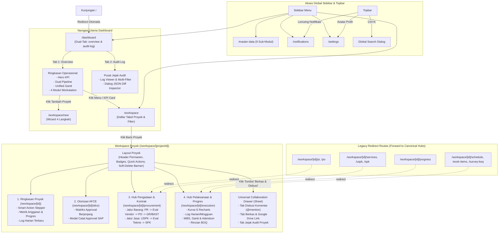

# Laporan Audit Kode & Arsitektur WM-Toolkit

> **Tanggal Audit:** 9 November 2026  
> **Aplikasi:** WM-Toolkit (Pencatatan & Monitoring Proyek Teknis Perkebunan Kelapa Sawit)  
> **Teknologi Utama:** Next.js 15.1.0 (App Router), React 19, TypeScript 5.7, Tailwind CSS 3.4, shadcn/ui, Recharts 2.15, Sonner  
> **Status Build:** Berhasil 100% (`pnpm build` sukses mengompilasi seluruh 33 rute App Router tanpa error TypeScript atau linting)

---

## Ringkasan Eksekutif

Audit ini dilakukan terhadap repositori **WM-Toolkit** setelah serangkaian pembaruan besar pada antarmuka dan alur operasional:
1. **Pembaruan Dashboard Operasional & Jejak Audit (`/dashboard`):** Transformasi dashboard menjadi Pusat Komando Operasional dua tab (`overview` & `audit-log`), dilengkapi filter interaktif wilayah & status fokus, visualisasi dua jalur pengadaan (*Dual-Track Pipeline Status Bar*), linimasa multi-proyek tunggal (*Unified Gantt Timeline*), workstation operasional 2-kolom seimbang (4 modul), serta pusat inspeksi jejak audit (*Audit Log Viewer* & *JSON Diff Detail Dialog*).
2. **Konsolidasi Workspace Proyek (`/workspace/[projectId]`):** Penyederhanaan navigasi detail proyek menjadi **4 Primary Integrated Tabs** (*Ringkasan Proyek*, *Otorisasi AFCE*, *Pengadaan & Kontrak*, dan *Pelaksanaan & Progres*), panduan siklus hidup interaktif (*Smart Action Stepper*), serta laci geser terpadu (*Universal Collaboration Drawer*) untuk diskusi komentar (@mention), dokumen berkas, dan log audit per proyek.

Aplikasi berstatus **Full-Stack Production-Ready** dengan database relasional PostgreSQL + Prisma ORM, Server Actions Next.js tervalidasi Zod + RBAC, autentikasi sesi NextAuth v5 (`Credentials` + `bcryptjs`), Google Drive API fail-fast, dan endpoint Vercel Cron `/api/cron/check-deadlines`. Seluruh cakupan fitur spesifikasi MVP (**F1 s/d F10** ditambah **AUTH**) terhubung penuh dari antarmuka hingga persistensi basis data beserta *Audit Log* tak terubah.

---

## 1. Pemetaan 33 Rute App Router

Hasil kompilasi build produksi Next.js mencatat **33 rute App Router aktif**, dengan pengelompokan fungsi sebagai berikut:

| No | Path Rute | Tipe Render | Berkas Sumber | Fungsi & Deskripsi Fitur |
|---|---|---|---|---|
| **A** | **Root & Autentikasi** | | | |
| 1 | `/` | Static (Redirect) | `src/app/page.tsx` | Entry point utama aplikasi; otomatis me-redirect pengguna ke `/dashboard`. |
| 2 | `/_not-found` | Static | `src/app/not-found.tsx` | Halaman penanganan 404 kustom dengan tombol kembali ke dashboard. |
| 3 | `/login` | Dynamic (SSR) | `src/app/login/page.tsx` | Halaman autentikasi pengguna berbasis NextAuth v5 Credentials Provider dengan verifikasi hash sandi `bcryptjs`, validasi form, dan indikator keamanan. |
| **B** | **Dashboard & Notifikasi** | | | |
| 4 | `/dashboard` | Dynamic (Server Hydrated) | `src/app/dashboard/page.tsx` | **Pusat Komando Operasional & Jejak Audit (Dual-Tab)**: Tab 1 Ringkasan Operasional (Hero KPI, Dual Pipeline, Unified Gantt, 4-Modul Workstation) & Tab 2 Pusat Jejak Audit (Audit Log Viewer & Diff Inspector). |
| 5 | `/notifications` | Dynamic (Server Hydrated) | `src/app/notifications/page.tsx` | **Pusat Notifikasi & Alarm EWS**: Filter tab (Semua, Belum Dibaca, Keterlambatan, Approval AFCE, Tugas Baru, Reminder Deadline), KPI peringatan, penanda sudah dibaca, dan pemicu manual cek deadline (khusus ADMIN) terhubung `/api/cron/check-deadlines`. |
| 6 | `/settings` | Dynamic (Server Hydrated) | `src/app/settings/page.tsx` | **Pengaturan Sistem & Profil**: Konfigurasi profil pengguna aktif (`fullName`, `email`, `bio`, `timeZone`), preferensi tema/tanggal/angka, sakelar notifikasi, ekspor snapshot JSON, serta pemeliharaan data khusus Admin. |
| **C** | **Monitoring & Master Data** | | | |
| 7 | `/workspace` | Static | `src/app/workspace/page.tsx` | **Daftar & Monitoring Proyek**: Data table interaktif, pencarian multi-parameter, filter lokasi/status/varians jadwal, pengaturan densitas tabel, aksi hapus proyek (*soft delete*), tombol restore recycle bin, dan ekspor data proyek. |
| 8 | `/workspace/new` | Static | `src/app/workspace/new/page.tsx` | **Wizard Pembuatan Proyek Baru (4 Langkah)**: Formulir multi-langkah: 1) Informasi Umum & Lokasi Wilayah/Kebun/Blok, 2) Jadwal Baseline & Durasi, 3) Anggaran & Dokumen AFCE, 4) Definisi WBS Awal. Dilengkapi *circular progress ring*. |
| 9 | `/master-data` | Static | `src/app/master-data/page.tsx` | **Hub Master Data**: Dashboard katalog ringkasan entitas organisasi, kebun, logistik, vendor rekanan, dan tata kelola beserta pintasan langsung ke sub-modul. |
| 10 | `/master-data/approval-matrix` | Static | `src/app/master-data/approval-matrix/page.tsx` | Konfigurasi matriks persetujuan berjenjang 9 level hierarki berdasarkan batas nilai anggaran belanja modal proyek. |
| 11 | `/master-data/locations` | Static | `src/app/master-data/locations/page.tsx` | Pengelolaan data multi-entitas organisasi: Wilayah Operasional (Region), Perusahaan (PT), Unit Kebun (Estate/PKS), serta Blok & Afdeling kebun sawit. |
| 12 | `/master-data/materials` | Static | `src/app/master-data/materials/page.tsx` | Katalog material konstruksi & sipil kebun sawit, kode material SAP, satuan standar, dan patokan harga. |
| 13 | `/master-data/procurement-types` | Static | `src/app/master-data/procurement-types/page.tsx` | Parameter klasifikasi metode pengadaan (Tender Terbuka, Tender Terbatas, Swakelola, Pembelian Langsung). |
| 14 | `/master-data/project-categories` | Static | `src/app/master-data/project-categories/page.tsx` | Klasifikasi bidang pekerjaan proyek kebun (Bangunan Air, Jalan & Jembatan, Infrastruktur Emplasmen, Konservasi). |
| 15 | `/master-data/project-types` | Static | `src/app/master-data/project-types/page.tsx` | Pengelompokan tipe proyek (Fisik/Konstruksi, Pengadaan Material Saja, Turnkey/Gabungan). |
| 16 | `/master-data/suppliers` | Static | `src/app/master-data/suppliers/page.tsx` | Direktori rekanan vendor/kontraktor (nama vendor, NPWP, kontak personal, telepon, kategori bidang, dan rating bintang). |
| 17 | `/master-data/users` | Static | `src/app/master-data/users/page.tsx` | Manajemen profil pengguna kebun, email, peran otorisasi, penugasan wilayah, dan status aktif. |
| **D** | **Workspace Proyek: 4 Hub Terpadu (Primary Tabs)** | | | |
| 18 | `/workspace/[projectId]` | Dynamic | `src/app/workspace/[projectId]/page.tsx` | **Primary Tab 1: Ringkasan Proyek (Overview)**: Memuat *Smart Action Stepper*, metrik ringkasan anggaran, durasi hari, status pengadaan, progres fisik, dan 5 log aktivitas harian terbaru. |
| 19 | `/workspace/[projectId]/afce` | Dynamic | `src/app/workspace/[projectId]/afce/page.tsx` | **Primary Tab 2: Otorisasi AFCE**: Visualisasi jenjang matriks persetujuan SAP, kartu status verifikasi per jabatan, log approval, dan modal dialog pencatatan persetujuan manual. |
| 20 | `/workspace/[projectId]/procurement` | Dynamic | `src/app/workspace/[projectId]/procurement/page.tsx` | **Primary Tab 3: Hub Pengadaan & Kontrak Terpadu**: Mengintegrasikan seluruh siklus **Jalur Barang** (PR, Evaluasi Rekanan Barang, PO, GR, BAST) dan **Jalur Jasa** (USPK, Evaluasi Teknis Jasa, Kontrak SPK Resmi) dalam satu antarmuka tab modular. |
| 21 | `/workspace/[projectId]/execution` | Dynamic | `src/app/workspace/[projectId]/execution/page.tsx` | **Primary Tab 4: Hub Pelaksanaan & Progres Terpadu**: Mengintegrasikan Kurva S fisik (Recharts), log harian & mingguan, struktur rincian kerja (WBS), matriks jadwal Gantt mingguan, adendum revisi jadwal, serta rincian Bill of Quantity (BOQ). |
| **E** | **Workspace Proyek: Sub-Rute Kompatibilitas (Redirect & Kolaborasi)** | | | |
| 22 | `/workspace/[projectId]/pr` | Dynamic (Redirect) | `src/app/workspace/[projectId]/pr/page.tsx` | Redirect Server Component ke `/workspace/[projectId]/procurement?track=barang`. |
| 23 | `/workspace/[projectId]/po` | Dynamic (Redirect) | `src/app/workspace/[projectId]/po/page.tsx` | Redirect Server Component ke `/workspace/[projectId]/procurement?track=barang`. |
| 24 | `/workspace/[projectId]/services` | Dynamic (Redirect) | `src/app/workspace/[projectId]/services/page.tsx` | Redirect Server Component ke `/workspace/[projectId]/procurement?track=jasa`. |
| 25 | `/workspace/[projectId]/uspk` | Dynamic (Redirect) | `src/app/workspace/[projectId]/uspk/page.tsx` | Redirect Server Component ke `/workspace/[projectId]/procurement?track=jasa`. |
| 26 | `/workspace/[projectId]/technical-evaluation` | Dynamic (Redirect) | `src/app/workspace/[projectId]/technical-evaluation/page.tsx` | Redirect Server Component ke `/workspace/[projectId]/procurement?track=jasa`. |
| 27 | `/workspace/[projectId]/spk` | Dynamic (Redirect) | `src/app/workspace/[projectId]/spk/page.tsx` | Redirect Server Component ke `/workspace/[projectId]/procurement?track=jasa`. |
| 28 | `/workspace/[projectId]/progress` | Dynamic (Redirect) | `src/app/workspace/[projectId]/progress/page.tsx` | Redirect Server Component ke `/workspace/[projectId]/execution?tab=progress`. |
| 29 | `/workspace/[projectId]/schedule` | Dynamic (Redirect) | `src/app/workspace/[projectId]/schedule/page.tsx` | Redirect Server Component ke `/workspace/[projectId]/execution?tab=schedule`. |
| 30 | `/workspace/[projectId]/survey-boq` | Dynamic (Redirect) | `src/app/workspace/[projectId]/survey-boq/page.tsx` | Redirect Server Component ke `/workspace/[projectId]/execution?tab=boq`. |
| 31 | `/workspace/[projectId]/work-items` | Dynamic (Redirect) | `src/app/workspace/[projectId]/work-items/page.tsx` | Redirect Server Component ke `/workspace/[projectId]/execution?tab=wbs`. |
| 32 | `/workspace/[projectId]/documents` | Dynamic | `src/app/workspace/[projectId]/documents/page.tsx` | Halaman repositori dokumen proyek, unggah berkas ke Google Drive via `/api/upload`, dan penautan Google Drive link. |
| 33 | `/workspace/[projectId]/comments` | Dynamic | `src/app/workspace/[projectId]/comments/page.tsx` | Halaman diskusi dan komentar tim proyek dengan deteksi mention `@user`. |

> **Catatan Arsitektur Layout Proyek:**
> Layout `src/app/workspace/[projectId]/layout.tsx` membungkus header proyek permanen, status badge, tombol aksi cepat, banner soft delete / pulihkan proyek, tombol pemicu laci geser `CollaborationDrawer` (*Berkas & Diskusi*), serta strip navigasi **4 Primary Integrated Tabs**. Sub-rute lama nomor 22-31 menjadi *Server Component redirect* menuju hub kanonik `/procurement` dan `/execution`, sementara rute 32-33 beserta `/history` tetap tersedia untuk akses langsung maupun melalui `CollaborationDrawer`.

---

## 2. Struktur Komponen Repositori

Komponen antarmuka tersusun terstruktur di bawah direktori `src/components/`:

### A. Komponen Tata Letak (Layout)
- `src/components/layout/app-layout-shell.tsx`: Pembungkus utama aplikasi yang menyatukan sidebar lipat, topbar, dan area konten responsif.
- `src/components/layout/app-sidebar.tsx`: Navigasi samping dengan collapsible state, pengelompokan menu Dashboard, Workspace, Master Data (dengan submenu lipat), dan Settings.
- `src/components/layout/app-topbar.tsx`: Header atas dengan indikator wilayah pengguna aktif, Global Search (`Ctrl+K`), dropdown lonceng notifikasi dinamis (menghitung proyek terlambat & AFCE pending approval), tombol tema gelap/terang, avatar profil pengguna, serta tombol keluar yang membersihkan sesi dan penyimpanan lokal terkait.
- `src/components/layout/global-search.tsx`: Palet perintah pencarian universal (`CommandDialog`) yang mengindeks kode proyek, nama proyek, dokumen AFCE, nomor PR, nomor PO, kebun, dan material.

### B. Komponen Dashboard (Pembaruan Utama)
- `src/components/dashboard/dashboard-filter-bar.tsx`: Komponen selektor filter Unit Kebun (dinamis dari master data `locations`) dan filter status fokus (`critical`, `in_progress`, `pending_afce`), badge jumlah proyek tersaring, dan tombol reset filter.
- `src/components/dashboard/pipeline-status-bar.tsx`: Visualisasi alur kerja dua cabang paralel pasca-AFCE: 4 tahapan Jalur Barang (*AFCE Setuju*, *PR Released*, *PO Terbit*, *GR Diterima*) dan 4 tahapan Jalur Jasa (*Usulan USPK*, *Eval Teknis Rekomendasi*, *SPK Aktif*, *Konstruksi Berjalan*).
- `src/components/dashboard/unified-gantt.tsx`: Linimasa multi-proyek tunggal terpadu multi-kebun. Menerima props proyek tersaring, kalkulasi rentang waktu otomatis, kontrol zoom 3 tingkat (*Weekly*, *Monthly*, *Quarterly*), filter status baris internal, garis penanda *Hari Ini* dengan auto-scroll halus, serta baris expandable WBS per proyek.
- `src/components/dashboard/dashboard-widgets.tsx`: Grid 2 kolom seimbang (7/12 & 5/12) menaungi 4 modul operasional:
  - *Modul A (Kiri Atas):* Pusat Tindakan & Atensi (Tab Antrean AFCE & Tab Peringatan EWS Kritis) dengan link aksi langsung.
  - *Modul B (Kiri Bawah):* Realisasi Progres Fisik & Kurva-S Mingguan (dual-bar rencana vs aktual).
  - *Modul C (Kanan Atas):* Pelacakan Pengadaan Dua Jalur (Tab Barang PR/PO & Tab Jasa SPK/USPK) dengan shortcut aksi.
  - *Modul D (Kanan Bawah):* Live Audit Feed 5 mutasi sistem terakhir dengan tombol inspeksi JSON Diff.
- `src/components/dashboard/audit-log-viewer.tsx`: Konsol Pusat Jejak Audit lengkap pada Tab 2 dashboard, memuat metrik ringkasan, multi-filter kategori entitas (*Barang, Jasa, AFCE, Proyek, Fisik*), filter jenis aksi, pencarian bebas, ekspor file CSV, dan daftar log audit kronologis.
- `src/components/dashboard/audit-log-detail-dialog.tsx`: Modal dialog inspeksi JSON Diff per rekaman audit log (*Before Data* vs *After Data*).
- `src/components/dashboard/kpi-card.tsx`: Komponen kartu ringkasan KPI eksekutif dengan ikon, tren, warna aksen semantik, dan tautan navigasi.

### C. Komponen Workspace & Siklus Hidup Proyek
- `src/components/workspace/smart-action-stepper.tsx`: Panduan visual tahapan siklus proyek (Inisiasi → Otorisasi AFCE → Pengadaan Barang/Jasa → Kontrak/PO → Pelaksanaan Fisik → Penutupan Proyek) yang mendeteksi status riil proyek dan memunculkan tombol aksi kontekstual berikutnya.
- `src/components/workspace/collaboration-drawer.tsx`: Laci geser samping (*Sheet*) yang menampung tab Diskusi Komentar (@mention), Dokumen Arsip & unggah/tautan Google Drive, serta linimasa Jejak Audit proyek.
- `src/components/workspace/schedule-gantt-matrix.tsx`: Matriks jadwal batang kerja mingguan per gugus pekerjaan teknis dengan sel status.
- `src/components/workspace/schedule-revision-dialog.tsx`: Modal dialog pengajuan revisi adendum waktu keterlambatan proyek dengan justifikasi cuaca/teknis dan pejabat pemberi izin.

### D. Komponen Pengadaan & Kontrak (Procurement & Services)
- `src/components/procurement/pr-record-dialog.tsx`: Dialog formulir pencatatan rilis PR SAP.
- `src/components/procurement/vendor-evaluation-dialog.tsx`: Dialog formulir pencatatan evaluasi vendor rekanan barang (rekomendasi teknis/komersial) sebagai guardrail sebelum menerbitkan PO.
- `src/components/procurement/po-create-dialog.tsx`: Dialog pembuatan Purchase Order multi-item material yang terhubung ke nomor PR dan vendor terpilih.
- `src/components/procurement/gr-receipt-dialog.tsx`: Dialog pencatatan penerimaan fisik barang parsial di kebun (Goods Receipt).
- `src/components/procurement/goods-handover-dialog.tsx`: Dialog pencatatan Berita Acara Serah Terima (BAST) barang formal antara pihak penyedia dan unit kebun.
- `src/components/services/uspk-create-dialog.tsx`: Dialog pembuatan Usulan SPK teknis jasa kebun.
- `src/components/services/technical-evaluation-dialog.tsx`: Dialog evaluasi teknis rekanan jasa (rekomendasi kelaikan kerja).
- `src/components/services/spk-create-dialog.tsx`: Dialog penerbitan kontrak resmi Surat Perintah Kerja (SPK).

### E. Komponen Otorisasi AFCE & Progres Lapangan
- `src/components/afce/afce-action-dialog.tsx`: Dialog pencatatan aksi approval AFCE manual (Approve, Revise, Reject) per level jabatan berdasarkan data SAP.
- `src/components/progress/daily-progress-dialog.tsx`: Dialog pelaporan aktivitas harian lapangan: volume terpasang, cuaca, jumlah tenaga kerja (manpower), catatan kendala, dan unggah foto lapangan via `/api/upload`.
- `src/components/progress/weekly-progress-dialog.tsx`: Dialog rekapitulasi progres mingguan untuk kalkulasi deviasi Kurva S.

### F. Komponen Komentar & Dokumen
- `src/components/comments/comment-form.tsx` & `comment-list.tsx`: Komponen percakapan tim dengan deteksi mention `@user`.
- `src/components/documents/gdrive-link-dialog.tsx` & `gdrive-upload-dialog.tsx`: Dialog penautan URL berkas Google Drive yang valid dan dialog unggah berkas ke Google Drive melalui `/api/upload`.

### G. Komponen Primitif UI (shadcn/ui & Radix UI)
Terletak pada `src/components/ui/` mencakup: `avatar`, `badge`, `button`, `card`, `command`, `dialog`, `dropdown-menu`, `input`, `popover`, `progress`, `searchable-select`, `select`, `separator`, `sheet`, `switch`, `table`, `tabs`, `textarea`, `timeline`, dan `tooltip`.

---

## 3. Mock Data & State Management Terkini

Aplikasi berjalan pada pola **React Context API + Web LocalStorage** dengan isolasi data yang reaktif:
- **Konteks Utama:** `src/context/app-state-context.tsx` (`AppStateProvider`).
- **Kunci Browser Storage:** `wm_toolkit_state_v1`.
- **Dataset Mock Seed Bawaan (`src/lib/mock-data/`):**
  - `projects.ts`: 5 proyek perkebunan sawit realistis dengan varians jadwal, WBS, BOQ, dan jadwal Gantt.
  - `afce.ts`: Dokumen AFCE dengan jejak riwayat approval berjenjang per nominal batas wewenang.
  - `procurement.ts`: Data PR, Evaluasi Vendor Barang, PO multi-item, Goods Receipt, dan BAST Serah Terima Barang.
  - `services.ts`: Data Usulan USPK, Evaluasi Teknis Rekanan Jasa, dan Kontrak SPK aktif.
  - `progress.ts`: Catatan log kemajuan fisik harian dan rekap capaian mingguan Kurva S.
  - `comments.ts` & `attachments.ts`: Percakapan diskusi dan berkas proyek (Google Drive link/upload).
  - `master-data.ts`: Wilayah operasional, perusahaan PT, kebun, blok afdeling, material, supplier, pengguna, matriks approval 9 level, kategori proyek, tipe proyek, dan tipe pengadaan.
  - `audit-logs.ts`: Rekaman jejak audit sistem immutable dengan data `beforeData` dan `afterData` JSON.
  - `notifications.ts`: Rekaman notifikasi multi-kategori dengan status keterbacaan.
- **Fungsi Pemulihan:** Tersedia tombol *Reset Mock Data* pada topbar dan tab pemeliharaan *Settings* untuk mengembalikan data awal secara instan.

---

## 4. Alur Navigasi Antar Halaman



---

## 5. Matriks Kesiapan Fitur Terhadap Cakupan MVP (PRD & MVP-SCOPE)

Seluruh 10 cakupan spesifikasi MVP wajib ditambah modul Autentikasi telah diimplementasikan secara penuh (*Full-Stack*) dengan persistensi PostgreSQL, Server Actions ber-RBAC, serta Audit Log otomatis:

| Kode | Fitur Spesifikasi MVP | Status Implementasi | Keterangan Evaluasi Implementasi |
|---|---|---|---|
| **F1** | CRUD Proyek + Progress | **Terimplementasi Penuh** | Wizard 4 langkah `/workspace/new`, penambahan & pengubahan WBS/BOQ, pencatatan log harian/mingguan fisik, soft delete & restore proyek, serta soft delete & restore AFCE/PR/PO/USPK/SPK di PostgreSQL. |
| **F2** | Pencatatan Approval AFCE Manual berbasis SAP | **Terimplementasi Penuh** | Visualisasi alur matriks wewenang berjenjang 9 level (`WM, EM, GEM, RH, PH, MCA, CFO, COO, Chairman`), pencatatan aksi approval (Approve/Revise/Reject) dengan bukti SAP dan lampiran terunggah. |
| **F3** | Jalur Barang: PR → Evaluasi Vendor → PO → Serah Terima | **Terimplementasi Penuh** | Rilis PR SAP, evaluasi vendor rekanan barang dengan guardrail proteksi penerbitan PO (wajib PR berstatus `RECOMMENDED`), pembuatan PO multi-item material, Goods Receipt (GR) parsial, dan BAST formal. |
| **F4** | Jalur Jasa: USPK → Evaluasi Teknis → SPK → Pelaksanaan | **Terimplementasi Penuh** | Pembuatan Usulan SPK teknis (USPK), evaluasi kelaikan teknis rekanan jasa, penerbitan kontrak resmi SPK (1:1 dari USPK direkomendasikan), dan pelacakan progress lapangan terhubung kontraktor pelaksana. |
| **F5** | Komentar & Mention Pengguna | **Terimplementasi Penuh** | Tersedia pada `CollaborationDrawer` dan `/comments`, autokomplet mention `@user`, penghapusan komentar berizin pemilik/Admin dengan konfirmasi dialog, dan hitungan komentar tersinkronisasi DB. |
| **F6** | Google Drive Integration (Upload / Link) | **Terimplementasi Penuh** | Unggah berkas melalui `/api/upload` dan penautan URL Drive melalui `GDriveLinkDialog` dengan perilaku fail-fast eksplisit jika kredensial Google Drive tidak tersedia (tanpa mock link atau PDF palsu). |
| **F7** | Notifikasi & Reminder (Keterlambatan, AFCE, Deadline) | **Terimplementasi Penuh** | Halaman `/notifications` dengan 6 filter tab, KPI peringatan, endpoint `/api/cron/check-deadlines`, pemicu manual khusus Admin, dropdown lonceng Topbar, dan preferensi notifikasi di `/settings`. |
| **F8** | Pencarian, Filter, Sorting, Pagination | **Terimplementasi Penuh** | Global Search universal (`Ctrl+K`) dengan scoping peran, filter multi-kriteria di `/workspace` dan dashboard, serta pagination client pada konsol `AuditLogViewer`. |
| **F9** | Dashboard & Laporan (Kurva S / Gantt) | **Terimplementasi Penuh** | Pusat komando 2-tab (`overview` & `audit-log`), 4 Hero KPI, *PipelineStatusBar*, *UnifiedGantt* multi-skala (Weekly/Monthly/Quarterly), 4 modul workstation, dan Kurva S Recharts mingguan. |
| **F10** | Audit Log Immutable | **Terimplementasi Penuh** | Tab 2 dashboard `/dashboard?tab=audit-log` dengan konsol jejak audit lengkap, ekspor CSV ber-BOM UTF-8, feed mutasi sistem, dan dialog inspeksi *Before vs After JSON Diff* lintas seluruh entitas sistem. |
| **AUTH** | Halaman Login & Otentikasi Pengguna | **Terimplementasi Penuh** | Halaman `/login` berbasis NextAuth v5 (`Credentials`), hashing sandi `bcryptjs`, proteksi rute `middleware.ts`, verifikasi sesi server pada setiap Server Action, serta profil lengkap (`bio`, `timeZone`, edit `email`). |

---

## 6. Status Penyelesaian Kesenjangan Teknis (Resolution Log)

Seluruh temuan kesenjangan arsitektur dan kebersihan kode dari audit awal telah diselesaikan:

| No | Kategori Perbaikan | Kondisi Awal | Status Saat Ini | Detail Implementasi Terkini |
|---|---|---|---|---|
| 1 | **Database & Persistensi** | Tersimpan di `localStorage` | **Selesai** | Seluruh entitas proyek, pengadaan, progress, lampiran, profil (`bio`, `timeZone`), master data, notifikasi, dan audit log dipersistensikan di PostgreSQL via Prisma ORM + Server Actions. |
| 2 | **Autentikasi & Sesi** | Login simulasi lokal | **Selesai** | Terintegrasi NextAuth v5 dengan Credentials Provider + `bcryptjs` serta `middleware.ts` untuk memproteksi seluruh rute privat. |
| 3 | **Penegakan Hak Akses (RBAC)** | Guard UI di sisi klien | **Selesai** | Validasi sesi server & peran (`ADMIN`, `PIC`, `VIEWER`) ditegakkan pada setiap Server Action mutasi serta API endpoint, termasuk guard anti-demote Admin terakhir. |
| 4 | **Integrasi Google Drive API Riil** | Dialog simulasi lokal & tautan mock | **Selesai** | Menggunakan Google Drive API melalui `/api/upload` dan `/api/files/[fileId]/download` dengan perilaku fail-fast jika kredensial tidak dikonfigurasi (tidak menghasilkan berkas atau URL palsu). |
| 5 | **Vercel Cron Backend** | Simulasi di browser | **Selesai** | Endpoint `src/app/api/cron/check-deadlines/route.ts` memeriksa proyek terlambat dan deadline mendekat; pemicu UI dibatasi khusus pengguna `ADMIN`. |
| 6 | **Pembersihan Berkas Usang (Dead Code)** | Berkas `services-widget.tsx`, `audit-log-feed.tsx`, `src/pages/`, dan data mock yatim | **Selesai** | Berkas tak terpakai, `src/pages/`, `multi-step-05.json`, serta berkas mock yang digantikan DB telah dihapus; hanya seed master data & helper template notifikasi yang dipertahankan. |

---

## 7. Analisis Risiko Operasional

1. **Risiko Kerapatan Informasi pada Layar Kecil (UX):**
   - Dashboard memuat 4 Hero KPI, Dual-Pipeline bar, linimasa Unified Gantt, dan 4 modul workstation operasional dalam satu layar.
   - *Mitigasi:* Sistem layout menggunakan grid responsif multi-breakpoint (`grid-cols-1 sm:grid-cols-2 lg:grid-cols-4`), drawer navigasi mobile berbasis Radix `Sheet`, scroll horizontal terarah pada linimasa Gantt, serta filter wilayah/fokus untuk mereduksi volume baris.
2. **Risiko Skalabilitas Query Agregasi:**
   - Saat ini payload ringkasan workspace dan dashboard dimuat melalui Server Actions terstruktur; untuk ribuan proyek aktif, penyaringan penuh dapat memengaruhi waktu respons.
   - *Mitigasi Mendatang:* Tambahkan pagination sisi server dan agregasi SQL langsung pada query dashboard jika volume proyek melewati ratusan entitas aktif bersamaan.
3. **Risiko Ketersediaan Kredensial Google Drive di Lingkungan Deployment:**
   - Karena sistem menerapkan perilaku fail-fast ketika kredensial Google Drive belum terpasang, fitur unggah file di produksi menuntut variabel environment OAuth/Service Account terkonfigurasi lengkap.
   - *Mitigasi:* Lakukan pengecekan kesehatan kredensial Google Drive saat deploy ke Vercel melalui endpoint atau script `scripts/test-google-drive.ts`.

---

## 8. Arsitektur Produksi Saat Ini

```
Tahap 1: Database & Skema (Selesai)
├── PostgreSQL + Prisma ORM (prisma/schema.prisma)
├── Skema proyek multi-kebun/blok (JSON), profil lengkap (bio, timeZone), & AuditEntityType menyeluruh
└── Soft delete & restore untuk Project, AFCE, PR, PO, USPK, dan SPK

Tahap 2: Autentikasi & Otorisasi (Selesai)
├── NextAuth v5 Credentials Provider + bcryptjs
├── Proteksi middleware.ts lintas rute App Router
└── RBAC Server Actions & guard anti-self-demote Admin

Tahap 3: Alur Pengadaan & Eksekusi Terpadu (Selesai)
├── Hub kanonik /procurement (Barang & Jasa) & /execution (Progres, WBS, Jadwal, BOQ)
├── Redirect Server Component pada 10 sub-rute kompatibilitas lama
└── Guardrail 1:1 USPK-SPK dan prasyarat Vendor Evaluation RECOMMENDED sebelum PO

Tahap 4: Cloud Storage, Cron & Standar UI (Selesai)
├── Integrasi Google Drive API fail-fast (/api/upload & download)
├── Endpoint Cron /api/cron/check-deadlines untuk EWS keterlambatan
└── Standar antislop, kontras WCAG AA (light & dark), dan zero AI-slop
```
