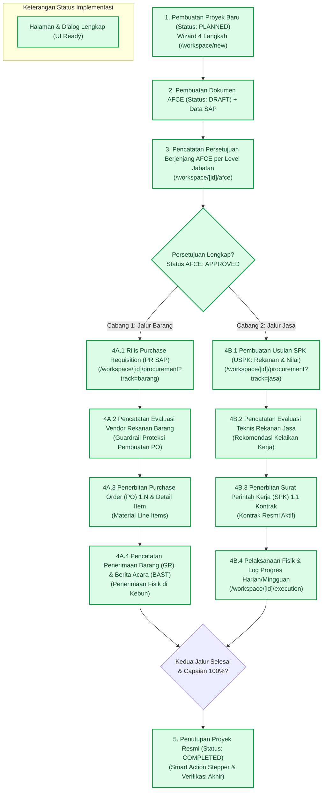

# Pemetaan Alur Kerja WM-Toolkit (FLOW-MAPPING)

> **Dokumen Referensi:** `AUDIT.md`, `docs/WORKFLOW.md`, `docs/PRD.md`, `docs/DATA-MODEL.md`, `docs/MVP-SCOPE.md`, `CONTEXT.md`  
> **Tanggal Pembaruan:** 9 November 2026  
> **Status:** 100% Terimplementasi (UI Ready) — Seluruh alur end-to-end telah memiliki antarmuka pengguna interaktif pada mock state.

---

## 1. Diagram Alur Kerja End-to-End & Status Halaman

Berikut adalah visualisasi alur kerja lengkap WM-Toolkit dari inisiasi hingga penyelesaian proyek:

---

## 2. Arsitektur Terpadu Workspace Proyek

Menjawab kebutuhan penyederhanaan antarmuka agar pengguna tidak kewalahan berpindah 11–15 tab terpisah, detail proyek pada `/workspace/[projectId]` diorganisasikan ke dalam **4 Primary Integrated Tabs** ditambah **Universal Collaboration Drawer**:

### A. 4 Primary Integrated Tabs
1. **Ringkasan Proyek (`/workspace/[projectId]`):**
   - *Smart Action Stepper*: Mendeteksi tahapan siklus hidup proyek secara otomatis (Inisiasi → AFCE → Pengadaan → Kontrak/PO → Pelaksanaan → Selesai) dan memberikan tombol aksi cerdas kontekstual berikutnya.
   - Kartu metrik anggaran belanja investasi vs realisasi, durasi hari baseline vs sisa target, serta log kemajuan harian terkini.
2. **Otorisasi AFCE (`/workspace/[projectId]/afce`):**
   - Matriks wewenang berjenjang 9 level hierarki berdasarkan tier nominal anggaran.
   - Pencatatan aksi persetujuan manual (Approve/Revise/Reject) dengan input nomor dokumen SAP, tanggal verifikasi, dan catatan.
3. **Hub Pengadaan & Kontrak Terpadu (`/workspace/[projectId]/procurement`):**
   - Mengintegrasikan kedua cabang pengadaan dalam satu hub dengan selektor tab cepat:
     - **Sub-Tab Jalur Barang:** Daftar PR released, riwayat evaluasi rekanan barang (*guardrail* tombol + Buat PO), penerbitan PO multi-item material, pencatatan Goods Receipt (GR) parsial, dan Berita Acara Serah Terima (BAST) formal.
     - **Sub-Tab Jalur Jasa:** Daftar usulan USPK, pencatatan evaluasi kelaikan teknis rekanan, penerbitan kontrak SPK resmi 1:1, dan pemantauan masa berlaku kontrak.
4. **Hub Pelaksanaan & Progres Terpadu (`/workspace/[projectId]/execution`):**
   - Mengintegrasikan seluruh aspek pemantauan fisik konstruksi:
     - Grafik Kurva-S Recharts rencana vs realisasi kumulatif mingguan.
     - Pencatatan log aktivitas harian (volume, cuaca, manpower, kendala, foto lapangan).
     - Rincian bobot Work Breakdown Structure (WBS 100%).
     - Matriks jadwal Gantt mingguan per grup pekerjaan teknis dan dialog adendum revisi jadwal waktu.
     - Bill of Quantity (BOQ) teknis lapangan.

### B. Universal Collaboration Drawer (`Sheet`)
- Dapat dibuka kapan saja dari header proyek permanen melalui tombol **"Berkas & Diskusi"** (lengkap dengan badge jumlah komentar + lampiran).
- Menampung 3 tab fungsional kolaborasi:
  1. **Tab Komentar & Diskusi:** Fitur percakapan tim dengan autokomplet mention `@user` dan cap waktu.
  2. **Tab Berkas Digital:** Repositori dokumen proyek, dialog penautan tautan berkas Google Drive (`GDriveLinkDialog`), modal simulasi unggah Google Drive (`GDriveUploadDialog`), dan pratinjau berkas (`AttachmentPreview`).
  3. **Tab Jejak Audit Proyek:** Rekaman riwayat aktivitas mutasi khusus untuk proyek bersangkutan.

### C. Kompatibilitas Sub-Rute Mandiri (Backward Compatibility)
Seluruh sub-rute lama tetap aktif dan berfungsi penuh untuk keperluan tautan langsung (*direct deep-linking*):
- `/workspace/[projectId]/pr`
- `/workspace/[projectId]/po`
- `/workspace/[projectId]/services`
- `/workspace/[projectId]/uspk`
- `/workspace/[projectId]/technical-evaluation`
- `/workspace/[projectId]/spk`
- `/workspace/[projectId]/progress`
- `/workspace/[projectId]/schedule`
- `/workspace/[projectId]/survey-boq`
- `/workspace/[projectId]/work-items`
- `/workspace/[projectId]/documents`
- `/workspace/[projectId]/comments`
- `/workspace/[projectId]/history`

---

## 3. Matriks Pemetaan Lengkap Alur Kerja

| No | Tahap Workflow (Sesuai `WORKFLOW.md`) | Status Coverage | Rute Halaman Utama | Komponen UI Utama |
|---|---|---|---|---|
| **1** | **Inisiasi Proyek Baru** (PLANNED) | **Lengkap (UI Ready)** | `/workspace/new` `/workspace` `/workspace/[projectId]` | `src/app/workspace/new/page.tsx` `smart-action-stepper.tsx` |
| **2** | **Pembuatan AFCE Awal** (DRAFT + Data SAP) | **Lengkap (UI Ready)** | `/workspace/new` (Step 3) `/workspace/[projectId]/afce` | Step 3 Wizard & Header `/afce` |
| **3** | **Pencatatan Approval AFCE Manual** (per level jabatan via SAP) | **Lengkap (UI Ready)** | `/workspace/[projectId]/afce` | `afce-action-dialog.tsx` |
| **4A.1** | **Jalur Barang: PR Rilis** (Nomor internal & SAP) | **Lengkap (UI Ready)** | `/workspace/[projectId]/procurement` `/workspace/[projectId]/pr` | `pr-record-dialog.tsx` |
| **4A.2** | **Jalur Barang: Evaluasi Vendor** (evaluator, tanggal, hasil) | **Lengkap (UI Ready)** | `/workspace/[projectId]/procurement` `/workspace/[projectId]/pr` | `vendor-evaluation-dialog.tsx` (Guardrail Buat PO) |
| **4A.3** | **Jalur Barang: PO Diterbitkan** (1 PR : N PO) | **Lengkap (UI Ready)** | `/workspace/[projectId]/procurement` `/workspace/[projectId]/po` | `po-create-dialog.tsx` |
| **4A.4** | **Jalur Barang: Serah Terima Barang** (GR & BAST formal) | **Lengkap (UI Ready)** | `/workspace/[projectId]/procurement` `/workspace/[projectId]/po` | `gr-receipt-dialog.tsx` `goods-handover-dialog.tsx` |
| **4B.1** | **Jalur Jasa: Usulan SPK (USPK)** (rekanan, nilai, scope) | **Lengkap (UI Ready)** | `/workspace/[projectId]/procurement` `/workspace/[projectId]/services` | `uspk-create-dialog.tsx` |
| **4B.2** | **Jalur Jasa: Evaluasi Teknis Jasa** (rekomendasi & catatan) | **Lengkap (UI Ready)** | `/workspace/[projectId]/procurement` `/workspace/[projectId]/services` | `technical-evaluation-dialog.tsx` |
| **4B.3** | **Jalur Jasa: Penerbitan SPK Resmi** (1 USPK : 1 SPK) | **Lengkap (UI Ready)** | `/workspace/[projectId]/procurement` `/workspace/[projectId]/services` | `spk-create-dialog.tsx` |
| **4B.4** | **Jalur Jasa: Pelaksanaan Fisik & Progres** (harian/mingguan) | **Lengkap (UI Ready)** | `/workspace/[projectId]/execution` `/workspace/[projectId]/progress` | `daily-progress-dialog.tsx` `weekly-progress-dialog.tsx` Kurva S Recharts |
| **5** | **Penyelesaian Proyek** (COMPLETED) | **Lengkap (UI Ready)** | `/workspace/[projectId]` | `smart-action-stepper.tsx` `status-badge.tsx` |
